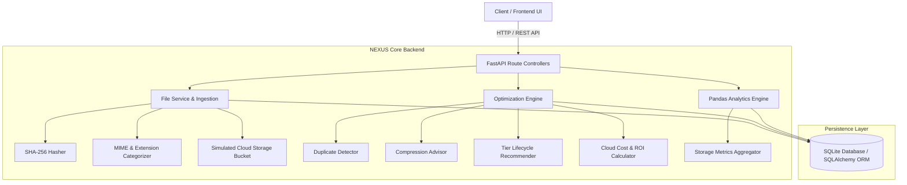

# NEXUS — Intelligent Cloud Storage Optimization System
## System Architecture & Technical Specifications

---

## 1. Executive Summary

**NEXUS** is an automated cloud storage optimization and analytics engine. It analyzes enterprise and user file storage patterns, identifies redundancies (exact duplicate files via cryptographic SHA-256 hashing), evaluates compressibility, recommends intelligent lifecycle tier migrations (Hot, Warm, Cold, Archive), and computes projected financial savings across cloud storage pricing models.

---

## 2. High-Level Architecture

---

## 3. Modular Component Design

### 3.1. Core & Database (`app/core/`)
- **`config.py`**: Manages environment variables, simulated bucket paths, cloud tier pricing structures (Hot, Warm, Cold, Archive), and optimization thresholds using Pydantic Settings.
- **`database.py`**: Manages the SQLite database engine, thread-safe connection pooling, SessionLocal factory, and `get_db` FastAPI dependency.

### 3.2. Data Models (`app/models/`)
- **`FileMetadata`**: Stores file name, path, byte size, cryptographic SHA-256 hash, MIME type, category, current storage tier, upload timestamp, and last-accessed timestamp.
- **`StorageTier`**: Defines operational and financial parameters for each cloud storage tier (Hot, Warm, Cold, Archive) including \$/GB/month rate and data retrieval charges.
- **`OptimizationLog`**: Records optimization recommendations, detected duplicate clusters, estimated compression ratios, and projected dollar savings.

### 3.3. File Processing & Storage Services (`app/services/` & `app/storage/`)
- **`hasher.py`**: Computes SHA-256 hashes using streaming chunk buffers (64 KB) to support large files without loading entire files into RAM.
- **`categorizer.py`**: Maps extensions and MIME types into high-level categories (`Document`, `Image`, `Video`, `Audio`, `Archive`, `Code`, `Other`).
- **`local_storage.py`**: Simulates a cloud object storage bucket on the local filesystem, handling file writing, path isolation, and safe cleanup.

### 3.4. Optimization Engine (`app/optimizer/`)
- **`duplicate_detector.py`**: Groups files by identical SHA-256 hash digests, identifying master vs redundant copies and computing recoverable storage bytes.
- **`compression_advisor.py`**: Evaluates file compressibility by format (e.g., text, logs, csv, code vs already-compressed media) and computes estimated compressed sizes and savings.
- **`tier_recommender.py`**: Evaluates file age and access latency requirements, recommending transitions from expensive Hot tiers to cost-effective Warm, Cold, or Archive tiers.
- **`cost_calculator.py`**: Computes monthly storage and retrieval costs before and after proposed optimizations to present clear financial ROI.

### 3.5. Analytics Engine (`app/analytics/`)
- **`engine.py`**: Leverages **Pandas** DataFrames for high-performance aggregations, calculating category distributions, size percentiles, wasted duplicate capacity, and optimization efficiency ratios.

### 3.6. REST API Controllers (`app/api/`)
- **`routes_files.py`**: Endpoints for uploading files, listing stored files, querying file details, and deleting files.
- **`routes_analytics.py`**: Endpoints for overall storage statistics, category breakdowns, and visual chart telemetry.
- **`routes_optimizer.py`**: Endpoints for running deduplication audits, compression evaluations, lifecycle recommendations, and cost-reduction reports.
- **`routes_tiers.py`**: Endpoints for viewing and configuring cloud storage tier rates.

---

## 4. Cloud Storage Tier Pricing Model

| Tier | Name | Target Access Frequency | Storage Cost (\$/GB/mo) | Retrieval Cost (\$/GB) | Min. Duration |
| :--- | :--- | :--- | :--- | :--- | :--- |
| **HOT** | Standard | Frequent (Daily / Weekly) | \$0.0230 | \$0.000 | 0 Days |
| **WARM** | Infrequent Access | Moderate (Monthly) | \$0.0125 | \$0.010 | 30 Days |
| **COLD** | Coldline | Rare (Quarterly) | \$0.0040 | \$0.030 | 90 Days |
| **ARCHIVE**| Glacier Deep | Long-term Archival (> 180 days)| \$0.00099 | \$0.050 | 180 Days |

---

## 5. Security & Isolation Considerations
- Local files are stored under a dedicated `storage_bucket/` folder without exposing system-level directories.
- No real cloud credentials or external network dependencies are required for local development and testing.
